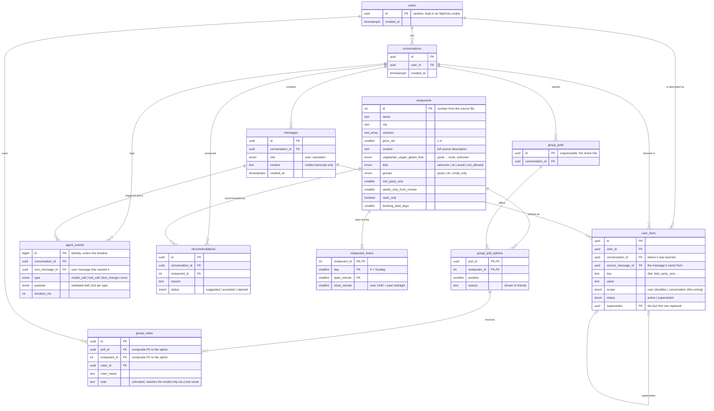

# Database architecture

Postgres on Neon, accessed only by the Next.js server through Drizzle. The schema lives in
[`src/db/schema.ts`](../src/db/schema.ts); the SQL it generates is in [`drizzle/`](../drizzle).

## What holds conversation state

Nothing lives in server memory between requests (serverless functions don't keep any). Each
turn rebuilds the model's context from three tables:

| Table | Role in the conversation |
|---|---|
| `messages` | The visible transcript the model re-reads every turn. |
| `user_facts` (status = active) | What the agent currently believes about the person: durable `user` facts plus this conversation's `conversation` facts. |
| `recommendations` | What was already suggested and how the person reacted. Rejected places are excluded from later searches. |

`agent_events` is the observability log: every model call (tokens, latency, stop reason), tool
call (input, output, error flag), and fact change, tied to the user message that caused it. The
inspector panel renders it. It also gives the model memory of its own actions: before each past
reply, the rebuilt transcript includes a one-line-per-call summary of that turn's tool calls
(never the full results), so the model knows its earlier picks were searched and verified.

## Invariants the database enforces

- **One current value per fact:** a partial unique index on `user_facts (user_id, key) WHERE status = 'active'`.
  A change of mind marks the old row `superseded` and inserts the new row pointing back at it, in one transaction.
- **A vote is for a real option in that poll:** `group_votes (poll_id, restaurant_id)` is a composite foreign key to `group_poll_options`.
- **One vote per person per poll:** a unique index on `group_votes (poll_id, voter_id)`; voting again updates the row.
- **Hours are sane:** check constraints on `day` (0-6) and `close_minute > open_minute`.
- **Deleting a user removes everything they own** (cascading foreign keys); restaurants are never cascaded.

## Why this shape

- **Facts as rows, not a profile blob:** each fact knows where it came from, and history survives changes of mind.
- **One event table with a typed `jsonb` payload:** it maps 1:1 to the `AgentEvent` TypeScript union, so the server, the database, and the inspector share one contract. Tradeoff: SQL can't constrain fields inside the payload, so Zod validates before insert.
- **Restaurants in the database:** recommendations, polls, and votes reference real rows. The hard-constraint filtering itself runs in TypeScript over the 50 rows so it can report *why* each place was excluded; at a larger scale the same predicates would move into SQL.
