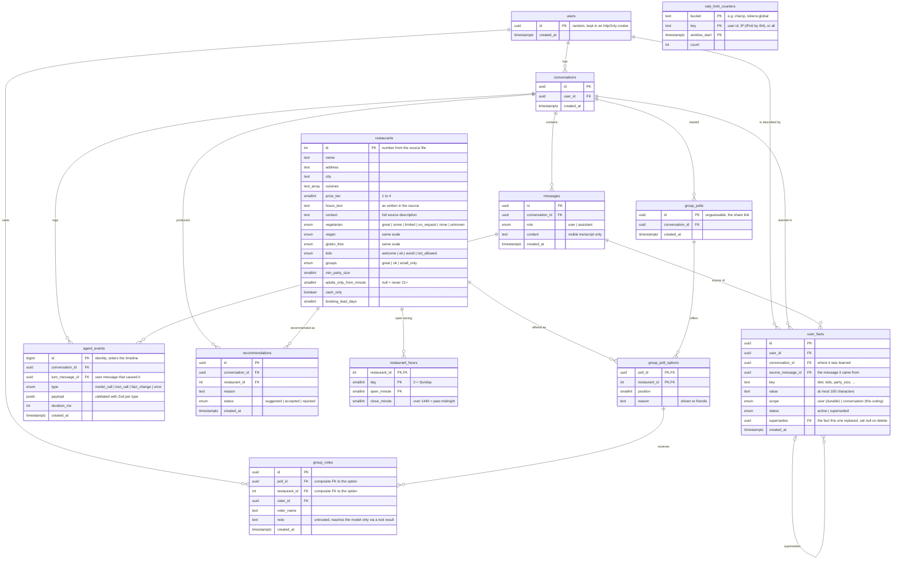

# Database architecture

Postgres on Neon, accessed only by the Next.js server through Drizzle. The schema lives in
[`src/db/schema.ts`](../src/db/schema.ts); the SQL it generates is in [`drizzle/`](../drizzle).
Production runs on Neon's `main` branch, local development on a `dev` branch, and every CI run
on a throwaway branch.

## What holds conversation state

Nothing lives in server memory between requests (serverless functions don't keep any). Each
turn rebuilds the model's context from the database:

| Source | Role in the conversation |
|---|---|
| `messages` | The last 30 visible messages, which the model re-reads every turn. |
| `agent_events` (latest search) | The hard constraints the conversation's last search applied, carried into this turn's searches. |
| `agent_events` (tool calls only) | A one-line-per-call trace placed before each past reply, so the model remembers what it *did* (searched, picked), not just what it said. Never the full tool results. |
| `user_facts` (status = active) | What the agent currently believes: durable `user` facts plus this conversation's `conversation` facts. |
| `recommendations` + `restaurants` | What was already suggested and how the person reacted. Rejected places are excluded from later searches. |
| `group_polls` + `group_poll_options` + `group_votes` | Vote counts per poll option. Voter names and notes are not put in the context; the model reads them only through a tool call. |

`agent_events` is also the observability log: every model call (input, cache-read and
cache-write tokens, latency, stop reason), tool call (input, output, error flag), and fact change,
tied to the user message that caused it. The inspector panel renders it.

`rate_limit_counters` holds fixed-window request counters (per IP, per user, global turns and
tokens per day). Counters older than two days are deleted on the first chat of each day.

## Invariants the database enforces

- **One current value per fact, per scope:** two partial unique indexes on `user_facts`, each
  `WHERE status = 'active'`. Durable facts are unique per `(user_id, key)` where `scope = 'user'`;
  situational facts are unique per `(conversation_id, key)` where `scope = 'conversation'`, so
  "party of 4" in one chat never collides with another chat. A change of mind marks the old row
  `superseded` and inserts the new row pointing back at it, in one transaction.
- **A vote is for a real option in that poll:** `group_votes (poll_id, restaurant_id)` is a
  composite foreign key to `group_poll_options`.
- **One vote per person per poll:** a unique index on `group_votes (poll_id, voter_id)`; voting
  again updates the row.
- **Sane catalog data:** check constraints on `price_tier` (1 to 4), `day` (0 to 6), and
  `close_minute > open_minute`.
- **Atomic counters:** `rate_limit_counters` is keyed by `(bucket, key, window_start)`, and each
  request does `INSERT ... ON CONFLICT DO UPDATE SET count = count + n`.

## Deletion

Deleting a user removes everything they own (cascading foreign keys); restaurants are never
cascaded. The app has no "delete conversation" action. If one were added: a fact's provenance
(`conversation_id`, `source_message_id`) cascades, so durable facts learned in that conversation
would be deleted with it, and a later fact that had superseded one of them keeps working with its
`supersedes` link set to null.

## Why this shape

- **Facts as rows, not a profile blob:** each fact knows where it came from, and history survives
  changes of mind.
- **One event table with a typed `jsonb` payload:** it maps 1:1 to the `AgentEvent` TypeScript
  union, so the server, the database, and the inspector share one contract. Tradeoff: SQL can't
  constrain fields inside the payload, so Zod validates before insert.
- **Restaurants in the database:** recommendations, polls, and votes reference real rows. The
  hard-constraint filtering itself runs in TypeScript over the 50 rows so it can report *why*
  each place was excluded; at a larger scale the same predicates would move into SQL.
